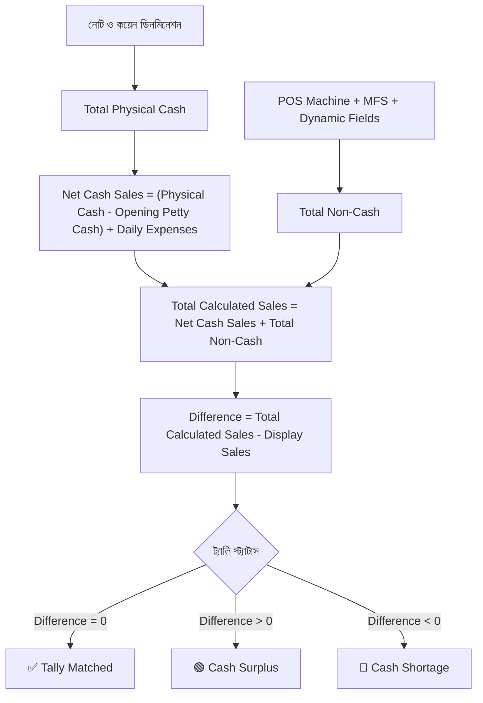

# ☕ Cha Joy - Daily Cash & Sales Reconciliation System
> **দৈনিক ক্যাশ ও বিক্রয় রিকনসিলিয়েশন সিস্টেম** — একটি আধুনিক, নির্ভুল ও স্বয়ংক্রিয় ওয়েব অ্যাপ্লিকেশন, যার মাধ্যমে ক্যাফে/রেস্তোরাঁর প্রতিদিনের ক্যাশ কাউন্টার, নন-ক্যাশ পেমেন্ট, খরচ এবং সফটওয়্যার বিক্রয়ের হিসাব এক নিমিষেই মিলিয়ে দেখা যায়।

---

## 📌 সূচিপত্র (Table of Contents)
1. [প্রজেক্ট ওভারভিউ (Project Overview)](#-প্রজেক্ট-ওভারভিউ-project-overview)
2. [ক্যালকুলেশন কীভাবে কাজ করে (How Calculations Work)](#-ক্যালকুলেশন-কীভাবে-কাজ-করে-how-calculations-work)
   - [১. নন-ক্যাশ পেমেন্ট হিসাব (Total Non-Cash)](#১-নন-ক্যাশ-পেমেন্ট-হিসাব-total-non-cash)
   - [২. ফিজিক্যাল ক্যাশ কাউন্ট (Total Physical Cash)](#২-ফিজিক্যাল-ক্যাশ-কাউন্ট-total-physical-cash)
   - [৩. নিট ক্যাশ বিক্রয় (Net Cash Sales)](#৩-নিট-ক্যাশ-বিক্রয়-net-cash-sales)
   - [৪. মোট গণনাকৃত বিক্রয় (Total Calculated Sales)](#৪-মোট-গণনাকৃত-বিক্রয়-total-calculated-sales)
   - [৫. পার্থক্য ও ট্যালি স্ট্যাটাস (Difference & Tally Status)](#৫-পার্থক্য-ও-ট্যালি-স্ট্যাটাস-difference--tally-status)
   - [৬. দিন শেষের ক্যাশ বণ্টন (Closing Cash Distribution)](#৬-দিন-শেষের-ক্যাশ-বণ্টন-closing-cash-distribution)
3. [GitHub Pages-এ হোস্ট করার পুরো প্রসেস (Hosting Guide)](#-github-pages-এ-হোস্ট-করার-পুরো-প্রসেস-hosting-guide)
   - [প্রয়োজনীয় কনফিগারেশন (Vite Base Path)](#প্রয়োজনীয়-কনফিগারেশন-vite-base-path)
   - [GitHub Actions Workflow তৈরি](#github-actions-workflow-তৈরি)
   - [গিটহাবে রিপোজিটরি পুশ ও পেজেস সক্রিয়করণ](#গিটহাবে-রিপোজিটরি-পুশ-ও-পেজেস-সক্রিয়করণ)
4. [প্রজেক্টের মূল ফিচারসমূহ (Key Features)](#-প্রজেক্টের-মূল-ফিচারসমূহ-key-features)
5. [ব্যবহৃত প্রযুক্তি (Tech Stack)](#-ব্যবহৃত-প্রযুক্তি-tech-stack)
6. [লোকালি চালানোর নিয়ম (Run Locally)](#-লোকালি-চালানোর-নিয়ম-run-locally)

---

## 🌟 প্রজেক্ট ওভারভিউ (Project Overview)

**Cha Joy** ক্যাফের জন্য তৈরি এই অ্যাপটি প্রতিদিনের শিফট শেষে ক্যাশ ড্রয়ারের টাকা গণনা এবং বিক্রয় সফটওয়্যারের (POS/Display Sales) হিসাবের মধ্যে কোনো গরমিল আছে কিনা তা তাৎক্ষণিকভাবে যাচাই করতে সাহায্য করে। এটি হিসাবের নির্ভুলতা নিশ্চিত করে, ক্যাশ ঘাটতি (Shortage) বা উদ্বৃত্ত (Surplus) দ্রুত শনাক্ত করে এবং একটি সুন্দর প্রফেশনাল ভাউচার/PDF রিপোর্ট তৈরি করে।

---

## 🧮 ক্যালকুলেশন কীভাবে কাজ করে (How Calculations Work)

অ্যাপ্লিকেশনের মূল গাণিতিক হিসাবগুলো [`src/utils/calculator.ts`](src/utils/calculator.ts) ফাইলের মাধ্যমে পরিচালিত হয়। নিচে প্রতিটি ধাপ সহজ বাংলায় ব্যাখ্যা করা হলো:



### ১. নন-ক্যাশ পেমেন্ট হিসাব (Total Non-Cash)
কার্ড, মোবাইল ব্যাংকিং বা অন্য যেকোনো ডিজিটাল মাধ্যমে আসা অর্থ যোগ করা হয়:
$$\text{Total Non-Cash} = \text{POS Machine} + \text{MFS (bKash/Nagad)} + \text{অন্যান্য কাস্টম ফিল্ড}$$

### ২. ফিজিক্যাল ক্যাশ কাউন্ট (Total Physical Cash)
ক্যাশ ড্রয়ারে থাকা সকল ব্যাংক নোটের সংখ্যা এবং ধাতব মুদ্রা গুণ করে মোট নগদ টাকা বের করা হয়:
$$\text{নোটের যোগফল} = (1000 \times n_1) + (500 \times n_2) + (200 \times n_3) + (100 \times n_4) + (50 \times n_5) + (20 \times n_6) + (10 \times n_7) + (5 \times n_8)$$
$$\text{Total Physical Cash} = \text{নোটের যোগফল} + \text{মোট কয়েন}$$

### ৩. নিট ক্যাশ বিক্রয় (Net Cash Sales)
ড্রয়ারে থাকা মোট ক্যাশ সবসময় শুধু আজকের বিক্রয় নয়; সকালে কিছু প্রারম্ভিক ক্যাশ ড্রয়ারে থাকে এবং দিনের বেলা ড্রয়ার থেকে কিছু খরচও হতে পারে। তাই মূল ক্যাশ বিক্রয় বের করার ফর্মুলা:
$$\text{Net Cash Sales} = (\text{Total Physical Cash} - \text{Opening Petty Cash}) + \text{Daily Expenses}$$

* **Opening Petty Cash কেন বিয়োগ হয়?** — কারণ এটি দিনের শুরুতে ড্রয়ারে থাকা আগের টাকা, আজকের বিক্রয় নয়।
* **Daily Expenses কেন যোগ হয়?** — কারণ দিনের দৈনন্দিন খরচ (দুধ, চিনি, আইস ইত্যাদি) ক্যাশ ড্রয়ারের টাকা থেকেই করা হয়েছে। খরচ না হলে টাকাটি ড্রয়ারের ক্যাশেই যুক্ত থাকত।

### ৪. মোট গণনাকৃত বিক্রয় (Total Calculated Sales)
নগদ ক্যাশ বিক্রয় ও সব ধরণের ডিজিটাল বিক্রয় একত্র করে প্রকৃত মোট বিক্রয় পাওয়া যায়:
$$\text{Total Calculated Sales} = \text{Net Cash Sales} + \text{Total Non-Cash}$$

### ৫. পার্থক্য ও ট্যালি স্ট্যাটাস (Difference & Tally Status)
সফটওয়্যার বা কাউন্টারে প্রদর্শিত বিক্রয়ের (Display Sales) সাথে আমাদের গণনাকৃত বিক্রয় তুলনা করা হয়:
$$\text{Difference} = \text{Total Calculated Sales} - \text{Display Sales}$$

ফলাফলের ওপর ভিত্তি করে স্ট্যাটাস নির্ধারিত হয়:
* **Tally Matched (হিসাব মিলেছে ✅)**: যদি $\text{Difference} = 0$ হয়।
* **Cash Surplus (উদ্বৃত্ত 🟢)**: যদি $\text{Difference} > 0$ হয় (হিসাবের চেয়ে ক্যাশে টাকা বেশি পাওয়া গেছে)।
* **Cash Shortage (ঘাটতি 🔴)**: যদি $\text{Difference} < 0$ হয় (হিসাবের চেয়ে ড্রয়ারে টাকা কম পাওয়া গেছে)।

### ৬. দিন শেষের ক্যাশ বণ্টন (Closing Cash Distribution)
হিসাব শেষ করার পর ড্রয়ারের ফিজিক্যাল ক্যাশ দুটি ভাগে নিষ্পত্তি করা যায়:
1. **Cash Withdrawal (ব্যাংক বা মালিকের কাছে হস্তান্তর)**: মালিককে দেওয়া বা ব্যাংকে জমা করার ক্যাশ।
2. **Next Day Petty Cash Float**: পরবর্তী দিনের সকালের ড্রয়ারের জন্য রেখে দেওয়া প্রাথমিক ক্যাশ।

---

## 🚀 GitHub Pages-এ হোস্ট করার পুরো প্রসেস (Hosting Guide)

এই অ্যাপ্লিকেশনটি **GitHub Pages** এবং **GitHub Actions CI/CD** দিয়ে সম্পূর্ণ ফ্রিতে হোস্ট করা হয়েছে। নিচে এর পূর্ণাঙ্গ ধাপগুলো দেওয়া হলো:

### প্রয়োজনীয় কনফিগারেশন (Vite Base Path)
GitHub Pages সাধারণত একটি সাব-পাথে হোস্ট হয় (যেমন: `https://<username>.github.io/<repository-name>/`)। তাই যাতে JavaScript এবং CSS ফাইলগুলো সহজে লোড হতে পারে, [`vite.config.ts`](vite.config.ts) ফাইলে `base` প্রোপার্টি আপেক্ষিক পথ (`./`) হিসেবে সেট করা হয়েছে:

```typescript
// vite.config.ts
export default defineConfig(() => {
  return {
    base: './', // GitHub Pages-এর জন্য আপেক্ষিক লিংক নিশ্চিত করে
    plugins: [react(), tailwindcss()],
    // ...
  };
});
```

---

### GitHub Actions Workflow তৈরি
প্রজেক্টের রুট ডিরেক্টরিতে [`.github/workflows/deploy.yml`](.github/workflows/deploy.yml) ফাইল রাখা হয়েছে, যা কোড পুশ করার সাথে সাথে প্রজেক্ট বিল্ড করে স্বয়ংক্রিয়ভাবে গিটহাব পেজেসে লাইভ করে দেয়:

```yaml
name: Deploy to GitHub Pages

on:
  push:
    branches:
      - main
  workflow_dispatch:

permissions:
  contents: read
  pages: write
  id-token: write

concurrency:
  group: 'pages'
  cancel-in-progress: true

jobs:
  build:
    runs-on: ubuntu-latest
    steps:
      - name: Checkout repository
        uses: actions/checkout@v4

      - name: Setup Node.js 22
        uses: actions/setup-node@v4
        with:
          node-version: 22
          cache: 'npm'

      - name: Install dependencies
        run: npm install --legacy-peer-deps

      - name: Build project
        run: npm run build

      - name: Upload Pages artifact
        uses: actions/upload-pages-artifact@v3
        with:
          path: './dist'

  deploy:
    environment:
      name: github-pages
      url: ${{ steps.deployment.outputs.page_url }}
    runs-on: ubuntu-latest
    needs: build
    steps:
      - name: Deploy to GitHub Pages
        id: deployment
        uses: actions/deploy-pages@v4
```

---

### গিটহাবে রিপোজিটরি পুশ ও পেজেস সক্রিয়করণ

#### ধাপ ১: কোড গিটহাবে পুশ করা
টার্মিনালে নিচের কমান্ডগুলো চালিয়ে কোড GitHub-এ পাঠানো হয়েছে:
```bash
# গিট ইনিশিয়ালাইজ (যদি না করা থাকে)
git init

# ফাইল যোগ ও কমিট
git add .
git commit -m "feat: complete cha joy sales reconciliation app"

# মেইন ব্রাঞ্চ নির্বাচন ও রিমোট লিংক যুক্ত করা
git branch -M main
git remote add origin git@github.com:Saon00/chajoy-cash-sales-reconciliation.git

# গিটহাবে কোড পুশ
git push -u origin main
```

#### ধাপ ২: GitHub Repository থেকে Pages সেটিংস অন করা
1. আপনার GitHub রিপোজিটরিতে যান: [https://github.com/Saon00/chajoy-cash-sales-reconciliation](https://github.com/Saon00/chajoy-cash-sales-reconciliation)
2. উপরের মেনু থেকে **Settings** ট্যাবে ক্লিক করুন।
3. বামপাশের মেনু থেকে **Pages** অপশনে যান।
4. **Build and deployment** সেকশনের অধীনে **Source** ড্রপডাউনে **"GitHub Actions"** সিলেক্ট করুন।

#### ধাপ ৩: লাইভ ওয়েবসাইট ভিজিট করা
* কোড পুশ হওয়ার সাথে সাথে GitHub Actions স্বয়ংক্রিয়ভাবে বিল্ড চালিয়ে কিছুক্ষণের মধ্যে ওয়েবসাইট লাইভ করে দেয়।
* আপনার লাইভ ওয়েবসাইটের লিংক:
  👉 **`https://saon00.github.io/chajoy-cash-sales-reconciliation/`**

---

## ✨ প্রজেক্টের মূল ফিচারসমূহ (Key Features)

- 🏢 **মাল্টি-ব্রাঞ্চ সাপোর্ট**: বাড্ডা শাখা (`Cha Joy - Badda - 1`) ও আফতাবনগর শাখা (`Cha Joy - Aftabnagar - 11`) নির্বাচন করার সুবিধা।
- 💵 **স্মার্ট ডিনমিনেশন কাউন্টার**: ১০০০ থেকে ৫ টাকার নোট এবং কয়েনের সংখ্যা ইনপুট দিলেই স্বয়ংক্রিয় মোট হিসাব।
- 💳 **নমনীয় পেমেন্ট মেথড**: POS কার্ড মেশিন, MFS (বিকাশ/নগদ) ছাড়াও যেকোনো কাস্টম নন-ক্যাশ পেমেন্ট ফিল্ড যোগ করার সুবিধা।
- ⚖️ **লাইভ রিকনসিলিয়েশন স্ট্যাটাস**: সাথে সাথে উদ্বৃত্ত, ঘাটতি বা মিল হওয়ার ভিজ্যুয়াল স্ট্যাটাস কার্ড।
- 📄 **প্রফেশনাল ভাউচার ও PDF ডাউনলোড**: ব্র্যান্ড লোগোসহ যেকোনো তারিখের হিসাব তাৎক্ষণিক প্রিভিউ ও PDF ফাইল আকারে সংরক্ষণ।
- 💾 **ডাবল ব্যাকআপ স্টোরেজ**: লোকাল স্টোরেজ (অফলাইন) এবং ফায়ারবেস ক্লাউড স্টোরেজ (অনলাইন)-এ স্বয়ংক্রিয় হিস্ট্রি সেভ।
- 📱 **সম্পূর্ণ রেসপনসিভ ও ক্লিন ডিজাইন**: মোবাইল, ট্যাবলেট ও ডেস্কটপে আরামদায়ক ব্যবহার।

---

## 🛠️ ব্যবহৃত প্রযুক্তি (Tech Stack)

- **Frontend Framework:** [React 19](https://react.dev/) + [TypeScript](https://www.typescriptlang.org/)
- **Bundler & Tooling:** [Vite](https://vitejs.dev/)
- **Styling:** [Tailwind CSS v4](https://tailwindcss.com/)
- **Icons:** [Lucide React](https://lucide.dev/)
- **PDF Generation:** [jsPDF](https://github.com/parallax/jsPDF)
- **Database / Cloud:** [Firebase Firestore](https://firebase.google.com/) & Browser LocalStorage
- **CI/CD & Hosting:** [GitHub Actions](https://github.com/features/actions) & [GitHub Pages](https://pages.github.com/)

---

## 💻 লোকালি চালানোর নিয়ম (Run Locally)

কম্পিউটারে লোকালি প্রজেক্টটি চালাতে নিচের ধাপগুলো অনুসরণ করুন:

1. **রিপোজিটরি ক্লোন করুন:**
   ```bash
   git clone git@github.com:Saon00/chajoy-cash-sales-reconciliation.git
   cd chajoy-cash-sales-reconciliation
   ```

2. **ডিপেন্ডেন্সি ইন্সটল করুন:**
   ```bash
   npm install
   ```

3. **ডেভেলপমেন্ট সার্ভার চালু করুন:**
   ```bash
   npm run dev
   ```
   এরপর ব্রাউজারে `http://localhost:3000` এ প্রবেশ করুন।

4. **প্রোডাকশন বিল্ড তৈরি করতে:**
   ```bash
   npm run build
   ```

---

<div align="center">
  <b>Made with ❤️ for Cha Joy Team</b>
</div>
